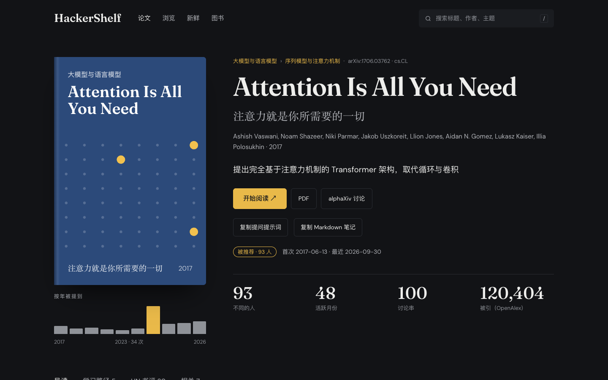
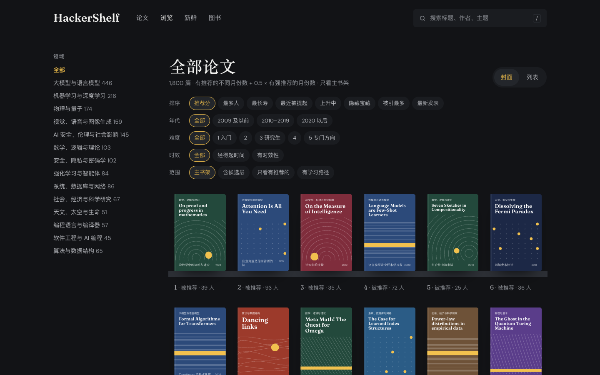
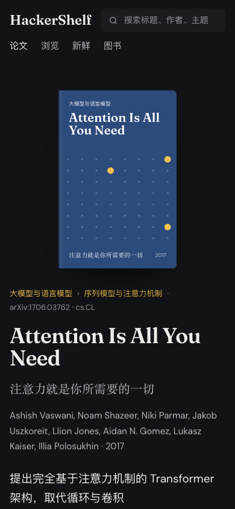

# HackerShelf · 公开书架

https://john-liu-dev.github.io/shelf/

Hacker News 二十年里被不同的人在不同月份反复推荐的论文：每篇有中文导读、HN 原话（链回原评论）、逐年提及、相关论文和学习路径。读论文去 arXiv 或 alphaXiv；详情页可以复制一段提问提示词贴进任意模型，或者复制一篇 Markdown 笔记。

另有一面开源书书架：同样按 HN 上反复推荐的程度排，只收开放许可或作者、出版社官方免费放出的完整版，每本配中文导读和读法。链接指向官方免费版，个别原站失效的会注明。

  
  

  
  

## 怎么选的

- 一条“提及”：评论里链接到这篇 arXiv 论文、评论者自己写的文字不少于 100 个字符；或者把论文直接发成帖子。
- 至少 3 个不同的人、在至少 3 个不同的月份提到过，进主书架；2 个人、2 个月的进候选层，一律写“被提及”。
- 每条评论的态度由 Claude 判断，排序按“有人推荐的月份数 + 0.5 × 有人强烈推荐的月份数”。
- 开源书：书单来自 free-programming-books，只认链接到官方免费版的提及，门槛同论文；许可证逐本到官方页面核实过。
- 主书架每月初更新一次；“新鲜”每天更新两次，GitHub 的定时任务常会晚几个小时。

## 这个仓库

只放构建好的静态站（`site/`）和每天生成“新鲜”书架的小脚本（`scripts/`）。页面由私有的源码仓库在本机构建后推送过来；GitHub Actions 每天两次抓 Hugging Face 每日论文、HN 上在讨论的 arXiv 论文和几个关注的 arXiv 分类，写成 `site/fresh.json` 再发布。网站不调用任何模型 API。

方法、管线、提示词和网站代码在 [john-liu-dev/open-hackershelf](https://github.com/john-liu-dev/open-hackershelf)。

## 数据来源与署名

- HN 数据：[open-index/hacker-news](https://huggingface.co/datasets/open-index/hacker-news)（ODC-By 1.0）和 [HN Algolia API](https://hn.algolia.com/api)。HN 原话保留作者名，并链回原评论。
- 论文元数据：arXiv（Thank you to arXiv for use of its open access interoperability）和 OpenAlex。不托管论文 PDF 或全文。
- 新鲜书架：Hugging Face Daily Papers、HN Algolia API、arXiv RSS。
- 开源书书单：EbookFoundation/free-programming-books（CC BY 4.0）。不托管书的全文。
- 封面由论文编号或书名生成；中文导读、卡片、读法和学习路径由 Claude 撰写，可能有错。

由 [john-liu-dev](https://github.com/john-liu-dev) 整理，个人学习用。
